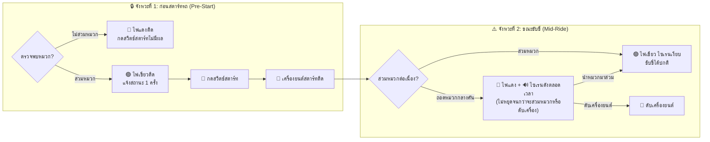

# 📊 แผนผังการทำงานของระบบ (System Flowchart)
## ระบบตรวจจับหมวกนิรภัยและควบคุมการสตาร์ทด้วยสวิตช์ (Smart Helmet Detection & Switch Interlock System)

---

## 1. ผังงานรวมการทำงานของระบบ (Overall System Flowchart)

```mermaid
flowchart TD
    %% จุดเริ่มต้น
    Start(["🟢 เริ่มต้นระบบ (เปิดสวิตช์กุญแจ)"]) --> Init["1. โหลดโมเดล AI ตรวจจับหมวกนิรภัย<br/>2. เปิดกล้องดิจิทัลตรวจจับผู้ขับขี่<br/>3. ตั้งค่าระบบเริ่มต้น: ล็อคระบบสตาร์ท (Engine OFF)"]

    Init --> CheckPre{"ผู้ขับขี่สวมหมวกนิรภัย<br/>ถูกต้องหรือไม่?"}

    %% ================= ขั้นตอนที่ 1: ก่อนออกรถ =================
    subgraph Step1 ["🔒 ขั้นตอนที่ 1: การตรวจสอบก่อนออกรถ (Pre-Start Check)"]
        %% กรณีไม่สวมหมวก
        CheckPre -->|"❌ ไม่สวมหมวก / ถอดหมวก"| RedStart["🔴 ไฟเตือนสีแดงติด (LED Red ON)<br/>ระบบตัดวงจรสตาร์ท"]
        RedStart --> SwitchDisabled["ผู้ขับขี่พยายามกดสวิตช์สตาร์ท<br/>⛔ กดสวิตช์ไม่มีผลใดๆ (รถสตาร์ทไม่ติด)"]
        
        %% เมื่อนำหมวกมาสวม หรือ สวมหมวกแต่แรก
        CheckPre -->|"✅ สวมหมวกถูกต้อง"| GreenStart["🟢 ไฟแสดงสถานะสีเขียวติด (LED Green ON)"]
        SwitchDisabled -->|"เมื่อผู้ขับขี่นำหมวกมาสวม"| GreenStart

        GreenStart --> ShowOnce["📢 แสดงสถานะพร้อมทำงาน (เพียง 1 ครั้ง)<br/>📸 บันทึกภาพลงโฟลเดอร์สวมหมวกถูกต้อง"]
        ShowOnce --> SwitchReady["🔘 ปลดล็อคระบบสตาร์ท (พร้อมกดสวิตช์)"]
        SwitchReady --> PressSwitch["ผู้ขับขี่กดสวิตช์สตาร์ทรถ"]
    end

    PressSwitch --> EngineStarted["🚀 เครื่องยนต์สตาร์ทติด (Engine ON)<br/>เริ่มจับเวลาการขับขี่ (Trip Stopwatch)<br/>รถพร้อมขับขี่ออกตัว"]

    %% ================= ขั้นตอนที่ 2: ขณะขับขี่ =================
    subgraph Step2 ["⚠️ ขั้นตอนที่ 2: การตรวจสอบขณะขับขี่ (Mid-Ride Monitoring)"]
        EngineStarted --> CheckRide{"ตรวจพบการสวมหมวกนิรภัย<br/>ต่อเนื่องหรือไม่?"}

        %% ขับขี่ปกติ สวมหมวก
        CheckRide -->|"✅ สวมหมวกต่อเนื่อง"| SafeRide["🟢 ไฟเขียวติดตลอด | 🔇 ไซเรนเงียบ<br/>ขับขี่ได้ตามปกติ"]

        %% แอบถอดหมวกกลางคัน
        CheckRide -->|"❌ ไม่เจอหมวก / ถอดกลางคัน"| Alarm["🔴 ไฟแดงติดทันที + 🔊 ส่งเสียงไซเรนเตือน<br/>(ส่งเสียงเตือนตลอดเวลาอย่างต่อเนื่อง ไม่หยุด!)<br/>📸 บันทึกภาพลงโฟลเดอร์ถอดหมวกกลางคัน"]

        Alarm --> CheckAction{"เงื่อนไขการหยุดส่งเสียงเตือน"}
        CheckAction -->|"1. นำหมวกกลับมาสวมใส่"| WearBack["🟢 ตรวจพบหมวกอีกครั้ง<br/>ดับเสียงไซเรน | ไฟเขียวกลับมาติด"]
        WearBack --> SafeRide

        CheckAction -->|"2. ดับเครื่องยนต์"| TurnOff["🛑 ผู้ขับขี่ดับเครื่องยนต์ (ปิดสวิตช์/กุญแจ)"]
        SafeRide -->|"ถึงที่หมาย / จอดรถ"| TurnOff
    end

    TurnOff --> EndState(["🔴 สิ้นสุดการทำงาน ปิดระบบ (Engine OFF)"])
```

---

## 2. ผังงานสรุปตรรกะแบบ 2 จังหวะ (Two-Phase Logic Flowchart)

---

## 3. ตารางสรุปสถานะการทำงานส่งอาจารย์ (State Summary Table)

| สภาวะของรถ | การตรวจพบหมวก | สถานะไฟ LED | การกดสวิตช์สตาร์ท | สถานะเครื่องยนต์ | เสียงไซเรนเตือน | เงื่อนไขการหยุดเตือน |
| :--- | :---: | :---: | :---: | :---: | :---: | :--- |
| **ก่อนสตาร์ท** | ❌ ไม่สวมหมวก / ถอดออก | 🔴 **ไฟแดงติด** | **กดสวิตช์ไม่มีผล** | ดับ (บิดคันเร่งไม่ไป) | เงียบ | - |
| **ก่อนสตาร์ท** | ✅ ตรวจพบหมวก | 🟢 **ไฟเขียวติด** *(แจ้งเตือน 1 ครั้ง)* | **กดสวิตช์ได้** | พร้อมสตาร์ท | เงียบ | - |
| **กดสวิตช์สตาร์ทแล้ว** | ✅ สวมหมวกต่อเนื่อง | 🟢 **ไฟเขียวติด** | - | ติด (ขับขี่ปกติ) | เงียบ | - |
| **กดสวิตช์สตาร์ทแล้ว** | ❌ แอบถอดหมวกกลางคัน | 🔴 **ไฟแดงติด** | - | ติด (วิ่งต่อได้) | 🔊 **ดังตลอดเวลา ไม่หยุด** | **ต้องนำหมวกกลับมาสวม** หรือ **ดับเครื่องยนต์** |

---

## 4. คำอธิบายการทำงานโดยละเอียด (สำหรับนำเสนออาจารย์/ใส่รายงาน)

1. **การยืนยันสถานะการตรวจพบหมวก (Single Trigger Notification)**:
   - เมื่อเปิดสวิตช์กุญแจและระบบตรวจพบการสวมหมวกนิรภัย ระบบจะเปิด **ไฟแสดงสถานะสีเขียว (LED Green)** และ **แสดงข้อความยืนยันสถานะเพียง 1 ครั้งเท่านั้น** พร้อมบันทึกภาพลงโฟลเดอร์สวมหมวกถูกต้อง เพื่อป้องกันการแจ้งเตือนซ้ำซ้อน
   
2. **การทำงานร่วมกับสวิตช์สตาร์ท (Safety Switch Interlock)**:
   - **กรณีไม่สวมหมวก**: ไฟเตือนสีแดงจะติดสว่าง หากผู้ขับขี่พยายามกดสวิตช์สตาร์ท ระบบจะไม่ตอบสนองใดๆ (กดสวิตช์ไม่มีผล) คันเร่งถูกตัด ป้องกันไม่ให้รถออกตัวโดยไม่สวมหมวก
   - **กรณีสวมหมวก**: ไฟสีเขียวจะติดสว่าง และปลดล็อคให้กดสวิตช์สตาร์ทได้ เมื่อกดสวิตช์สตาร์ทแล้ว รถจะพร้อมขับขี่ทันที

3. **การส่งสัญญาณเตือนกรณีถอดหมวกหลังสตาร์ท (Continuous Alert Until Safe or Shutdown)**:
   - หากผู้ขับขี่กดสวิตช์สตาร์ทรถแล้ว แต่เกิดการ **แอบถอดหมวกนิรภัยออกกลางคัน**:
     - 🔴 ไฟเตือนสีแดงจะติดสว่างขึ้นทันที
     - 🔊 เสียงไซเรนเตือน (Buzzer) จะ **ส่งเสียงดังตลอดเวลาอย่างต่อเนื่อง โดยไม่หยุด**
     - สัญญาณไฟแดงและเสียงเตือนจะ **หยุดลงได้เพียง 2 กรณีเท่านั้น**:
       1. **ผู้ขับขี่นำหมวกกลับมาสวมใส่ (ตรวจเจอหมวกอีกครั้ง)**: ระบบจะดับเสียงไซเรนทันที และเปลี่ยนไฟเป็นสีเขียว ขับขี่ต่อได้ตามปกติ
       2. **ผู้ขับขี่ดับเครื่องยนต์**: เมื่อปิดสวิตช์หรือดับเครื่อง ระบบจะหยุดส่งเสียงเตือน และกลับไปสู่ขั้นตอนก่อนสตาร์ทใหม่
